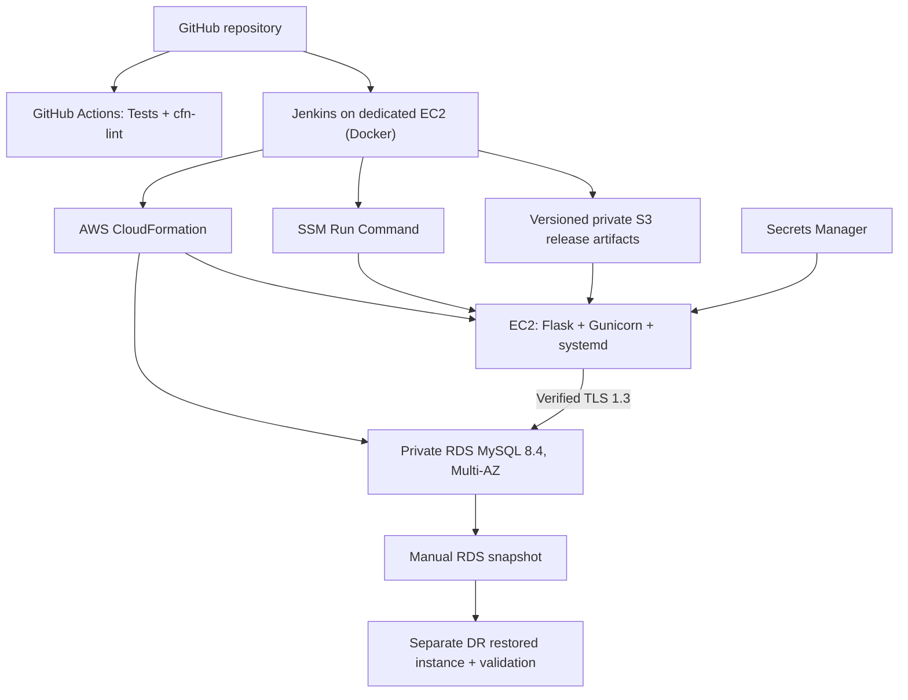

# NSRL Cloud Query Platform
**AWS Cloud Computing · CI/CD · Multi-AZ MySQL · Disaster Recovery**

[](https://github.com/Fadil1212/nsrl-mysql-cloud-webapp-workshop/actions/workflows/ci.yml)


An end-to-end AWS engineering project for **CSCI 6907 at The George Washington University**. A Python/Flask search application queries a curated National Software Reference Library (NSRL) dataset in private **Amazon RDS MySQL 8.4**. Infrastructure and delivery are automated with **GitHub Actions, Dockerized Jenkins, CloudFormation, Amazon S3, and AWS Systems Manager**.

**Verified outcome (November 21, 2026):** Jenkins Build #3 completed **SUCCESS**. A forced Multi-AZ failover switched the database primary from **us-east-1c to us-east-1b**; the application reconnected and queries succeeded. A manual snapshot restored to a separate instance, where encrypted connectivity and all four dataset counts were verified.

**[Architecture](docs/ARCHITECTURE.md) · [Validated results](docs/RESULTS.md) · [Operations and cleanup](docs/OPERATIONS.md) · [Jenkinsfile](Jenkinsfile) · [GitHub CI](.github/workflows/ci.yml)**

## Architecture



The app is reached through **SSM port forwarding**, rather than a public web URL. The EC2 host has a public IP for bootstrap/outbound connectivity, but inbound app port 8080 is restricted by security groups. MySQL permits access only from the application and Jenkins security groups.

## Features

- **Search dashboard + REST APIs** — MD5, SHA-1, SHA-256; partial filename/package, operating system, manufacturer, and file-size filters.
- **Reproducible releases** — S3 object version IDs, release manifest, SHA-256 verification, source-commit linkage.
- **Deployment automation** — GitHub Actions CI; Jenkins parameterized CD; AWS CloudFormation provisioning; Systems Manager remote application updates.
- **Secure database connections** — Secrets Manager for credentials, encrypted RDS storage, required TLS, and CA/hostname-verified MySQL connectivity.
- **Availability and recovery** — Forced standby promotion, live app reconnection, manual RDS snapshot and restore, recovered-data validation.

### Application API

| Route | Purpose |
| --- | --- |
| `GET /` | Interactive query dashboard |
| `GET /healthz` | Database health and TLS metadata |
| `GET /api/info` | Release details and live RDS topology |
| `GET /api/stats` | Dataset counts, TLS and source revision |
| `GET /api/search?file_name=.exe&manufacturer=Microsoft&limit=25` | Filtered, parameterized SQL search |
| `GET /api/hash/<digest>` | Exact hash lookup |

The application parameterizes SQL values and caps result limits at 200. Tested MD5 sample: `51580C2AEA9DE8E933C858A34502F78D`.

## Validated results

| Verification | Observed result |
| --- | --- |
| Jenkins | **Build #3: SUCCESS** |
| Forced failover | **us-east-1c → us-east-1b**, application reconnected |
| AWS failover events | Approximately **42.4 seconds** between started/completed event timestamps; not a measured user-facing outage |
| Manual snapshot | **181 seconds** |
| Restored instance available | **575 seconds** |
| Restored data | 10,000 files; 85,885 packages; 309 operating systems; 2,624 manufacturers |
| Database TLS | **TLSv1.3 · TLS_AES_256_GCM_SHA384** |
| Recovery cleanup | Deletion requested for temporary restored instance; later absent from RDS listing |

Counts were unchanged after failover and restoration. This is one observed course-lab execution, **not** an RTO/RPO SLA or a general performance benchmark. See [results and evidence](docs/RESULTS.md).

## CI/CD sequence

1. **GitHub Actions** runs unit tests, MySQL integration checks, and CloudFormation linting on pushes and pull requests.
2. **Jenkins** checks out the repository using a read-only deploy key, reruns tests, and validates the template.
3. Jenkins performs **network preflight**, then provisions the RDS/EC2/S3 infrastructure with **CloudFormation**.
4. Jenkins publishes **versioned, encrypted S3 objects**, downloads exact object versions, and verifies SHA-256 hashes.
5. The NSRL data is loaded over **verified TLS**; Jenkins deploys Flask to EC2 using **SSM Run Command** and verifies the API.
6. An **explicitly enabled** resilience stage tests forced Multi-AZ failover, app reconnection, snapshot restoration, TLS, counts, and temporary DB cleanup.

**Safety:** `RUN_DEPLOYMENT` and `RUN_FAILOVER_DR_TEST` default to `false`. Do not execute destructive resilience tests on a production database.

## Getting started

Requirements: Python 3.12+, Git, AWS CLI, suitable AWS permissions/VPC and subnet group, and the included curated NSRL data. The reference run used AWS Academy Learner Lab IAM roles: **deployment will require adaptation outside that environment**.

```bash
python -m venv .venv
# Windows PowerShell: .venv\Scripts\Activate.ps1
# Linux/macOS: source .venv/bin/activate
python -m pip install -r requirements.txt
python -m unittest discover -s tests -v
```

Deployment is driven by the parameterized [Jenkinsfile](Jenkinsfile). Review [operations, limitations, and cleanup](docs/OPERATIONS.md) before creating AWS resources.

## Repository contents

| Path | Contents |
| --- | --- |
| [app/](app/) | Flask API and query dashboard |
| [data/](data/) | Curated NSRL data and checksum manifest |
| [sql/](sql/) | MySQL schema |
| [infra/](infra/) | CloudFormation and Jenkins Docker image |
| [scripts/](scripts/) | Deployment, S3 integrity, verification and DR helpers |
| [tests/](tests/) | Automated tests |
| [.github/workflows/](.github/workflows/) | GitHub Actions CI |
| [docs/](docs/) | Architecture, test measurements, operations |

### Screenshots

The original course-lab screenshots are documented in the final assignment report. Curated, sanitized screenshots may be added to a future `docs/screenshots/` directory. The locally forwarded address (`127.0.0.1:18089`) is **not a public demo endpoint**.

## Scope and limitations

This is a **coursework demonstration**, not an enterprise-managed service. It uses a curated subset of NSRL, not the complete NSRL corpus. Matching table counts confirm the demonstrated recovery checks but do not imply cryptographic equality of every row. Failover event duration is not equivalent to application downtime. AWS resources can incur charges; the CloudFormation S3 bucket uses a **Retain** policy and the database uses a **Snapshot** deletion policy, so stack removal alone does not clean up everything.

**Author:** Fadil Surur · **Course:** CSCI 6907 Cloud Computing · **University:** The George Washington University · **Validated:** November 21, 2026
